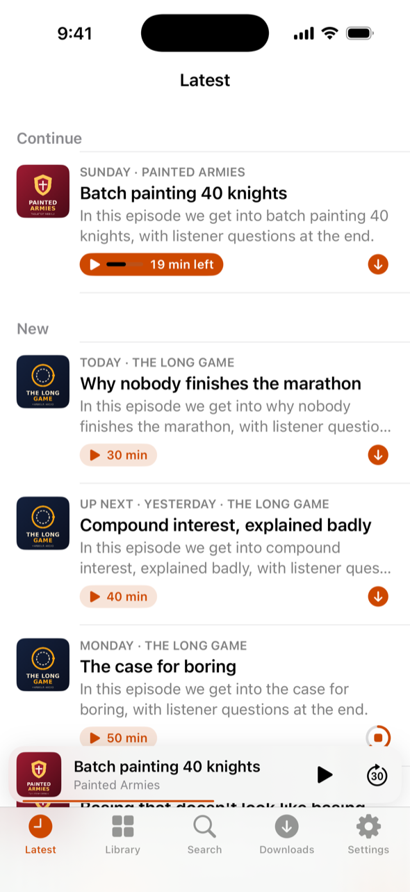
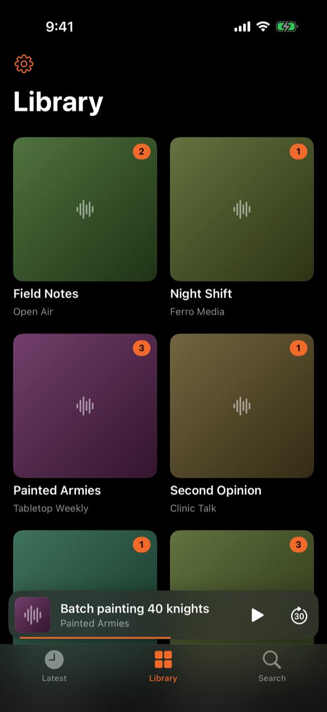
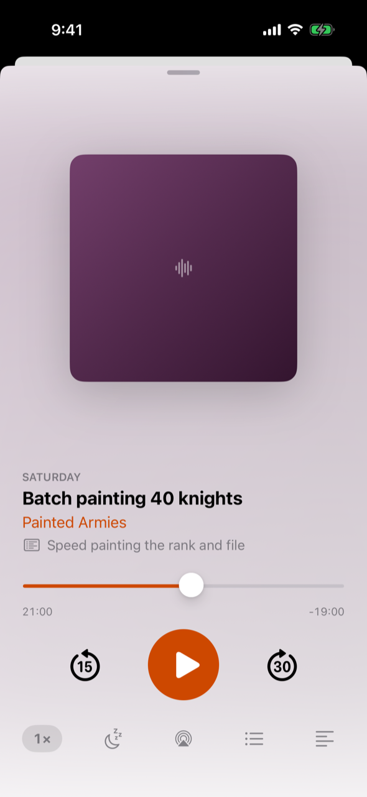
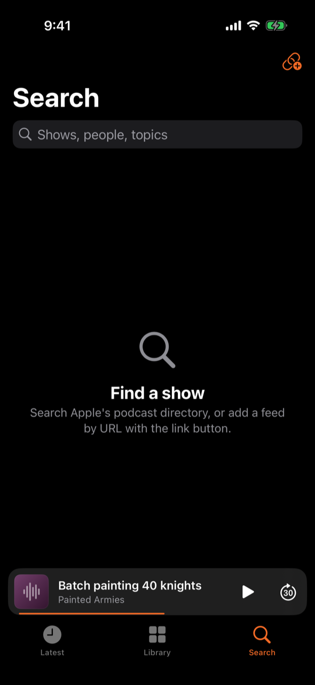
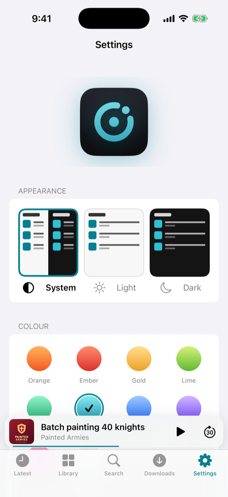
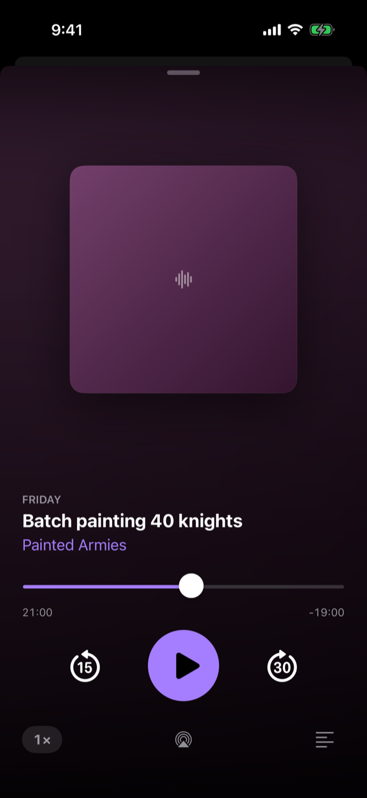
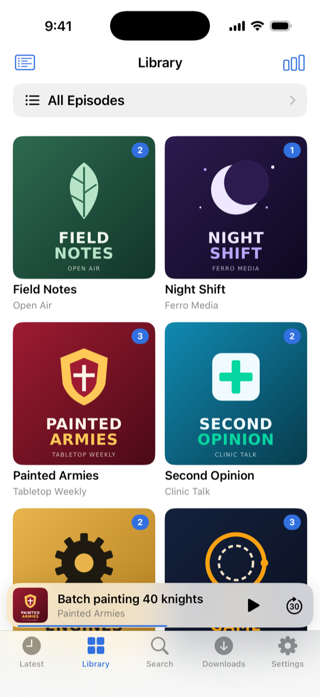

# Orbit

A podcast player for iPhone. SwiftUI and SwiftData, iOS 17+, needs Xcode 16 or later.

| Latest | Library | Player | Search |
|---|---|---|---|
|  |  |  |  |

| Settings | Violet | Blue |
|---|---|---|
|  |  |  |

Screenshots use built-in demo data. Regenerate them from Actions → iOS build → Run workflow.

## What it does

- Search Apple's podcast directory, or add any RSS feed by URL (private and paid feeds).
- Follow shows. New episodes from everything you follow appear under Latest, with in-progress ones under Continue.
- Streams episodes with background audio, lock screen and Control Centre controls, AirPlay,
  back 15 / forward 30 seconds and 0.8× to 2× speed.
- Remembers where you stopped in every episode. Swipe right on an episode to mark it played.
- Ten colour themes (orange by default) in Settings, the gear on Latest or Library. "Match app
  icon" swaps the Home Screen icon to the same colour.

Not built yet: downloads for offline listening, an Up Next queue, a sleep timer, chapters, background refresh, CarPlay.

## Run on your Mac

    git clone -b claude/eloquent-davinci-jay3rl https://github.com/tom-landy/warhound_1.0.git
    cd warhound_1.0
    open Orbit.xcodeproj

Pick an iPhone simulator in the toolbar and press Cmd+R. To see the app full of sample shows,
Product → Scheme → Edit Scheme → Run → Arguments, and add `-demo`.

## Run on your iPhone

1. Plug the phone in (or pair it over Wi-Fi in Window → Devices and Simulators).
2. On the phone: Settings → Privacy & Security → Developer Mode → on, then restart.
3. In Xcode: select the Orbit target → Signing & Capabilities → Team → your Apple ID
   (add it under Xcode → Settings → Accounts if it isn't listed). With a free Apple ID the app
   expires after 7 days and needs re-running from Xcode.
4. Change the bundle ID `com.tomlandy.Orbit` if it clashes. Pick the final one before your
   first TestFlight upload, since it can't change after that.
5. Pick the phone as the run destination and press Cmd+R. The first time, trust the developer
   on the phone under Settings → General → VPN & Device Management.

## Layout

    Orbit/
      OrbitApp.swift         app entry, storage setup, theme
      Models/                Podcast, Episode (SwiftData)
      Services/              RSS parser, directory search, feed fetch and refresh
      Player/AudioPlayer.swift   AVPlayer, lock screen, resume positions
      Views/                 tabs, lists, mini player, full player, settings, themes and logo
      DemoData.swift         sample library for screenshots (-demo)
    Orbit-Info.plist      background audio, export compliance
    design/                  logo template, theme colours, icon renderer

To change the logo or add a theme: edit `design/logo-template.svg` or `design/themes.json`,
run `node design/render-icons.js` (needs Playwright) to regenerate every app icon, and mirror
the change in `Orbit/Views/AccentTheme.swift` (colours and the in-app `LogoView`).

The Xcode project uses a synchronised folder, so any file added under `Orbit/` is picked up
automatically with no project-file edits.

Version: shown in Settings → About. Each update goes up by one (0.10, 0.11, 0.12…);
run `tools/bump-version.sh` before committing an update. It bumps the iPhone and watch apps
together and keeps the build number in step (0.11 → build 11), which TestFlight needs.

`.github/workflows/ios.yml` builds for the simulator on every push. Running it by hand also
takes screenshots and commits them to `docs/screenshots`.
